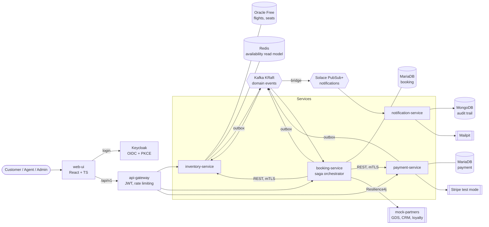

# SkyBook - Airline Reservation & Servicing Platform

SkyBook is an airline booking platform built as event-driven microservices. Customers search
flights, hold seats (holds expire after 15 minutes), pay with Stripe (test mode), receive a ticket,
and can change or cancel the booking with a refund. Agents and admins manage flights and inventory
and service bookings.

The project shows production engineering concerns rather than CRUD: no overbooking under
concurrent load, sagas with compensations, a transactional outbox, idempotent APIs and consumers,
resilience around unreliable partners, OAuth2/OIDC security with mTLS, and full observability.
Everything runs locally on free, open-source tools.

> **Status:** built in phases. See [Roadmap](#roadmap).

## Architecture



| Concern            | Approach                                                                              |
|--------------------|---------------------------------------------------------------------------------------|
| Consistency        | Database per service, an orchestrated saga in booking-service, a transactional outbox |
| Delivery           | At-least-once Kafka events, idempotent consumers, per-consumer dead-letter topics |
| Resilience         | Timeouts, retries with backoff, circuit breakers and bulkheads per partner; graceful fallbacks |
| Security           | Keycloak OIDC (PKCE for the SPA), JWT on every service, method-level RBAC, mTLS, encrypted PII, Vault |
| Seat allocation    | Decided only by inventory-service against Oracle, using optimistic locking and expiring holds |
| Read scaling       | Seat maps and availability come from a Redis cache-aside read model, evicted after every committed change |
| Errors             | RFC 9457 `application/problem+json` with a stable `code` and a `correlationId`        |
| Traceability       | `X-Correlation-Id` on every request, log line (MDC) and event envelope                |

Decisions are recorded in [docs/adr](docs/adr):
[0001 architecture style](docs/adr/0001-architecture-style.md) ·
[0002 platform versions](docs/adr/0002-platform-versions.md) ·
[0003 local footprint](docs/adr/0003-local-runtime-footprint.md) ·
[0004 CI platform](docs/adr/0004-ci-platform.md) ·
[0005 hexagonal booking](docs/adr/0005-hexagonal-booking-service.md) ·
[0006 seat concurrency](docs/adr/0006-seat-allocation-concurrency.md) ·
[0007 idempotency](docs/adr/0007-idempotency.md) ·
[0008 API security](docs/adr/0008-api-security-model.md) ·
[0009 PII encryption](docs/adr/0009-pii-encryption-at-rest.md) ·
[0010 mTLS](docs/adr/0010-mutual-tls.md) ·
[0011 secrets](docs/adr/0011-secrets-management.md) ·
[0012 API gateway](docs/adr/0012-api-gateway.md) ·
[0013 outbox](docs/adr/0013-transactional-outbox.md) ·
[0014 booking saga](docs/adr/0014-booking-saga.md) ·
[0015 resilience and contracts](docs/adr/0015-resilience-and-contracts.md) ·
[0016 Solace for notifications](docs/adr/0016-solace-for-notifications.md)

## Repository layout

```
skybook/
├─ pom.xml               Parent POM: Boot 4.0 and Cloud 2025.1 BOMs, Checkstyle, JaCoCo gate, enforcer
├─ api/                  OpenAPI 3 specs (source of truth for server interfaces and clients)
├─ libs/common/          Shared technical building blocks (no business logic)
│   ├─ error/            ErrorCode, SkyBookException, GlobalProblemHandler (RFC 9457)
│   ├─ web/              CorrelationIdFilter, CorrelationId
│   ├─ event/            EventEnvelope<T>, EventTypes (framework-free)
│   ├─ money/            Money value type (framework-free)
│   ├─ security/         Keycloak role mapping, API security baseline, Caller
│   └─ autoconfigure/    Spring Boot auto-configuration for servlet services
├─ libs/messaging/       Transactional outbox + Kafka relay, idempotent consumers, dead-letter topics
├─ services/
│   ├─ api-gateway/        Edge: routing, JWT, rate limiting, CORS, circuit breakers (Spring Cloud Gateway)
│   ├─ inventory-service/  Flights, seats, holds, pricing (layered; Oracle + Redis)
│   ├─ booking-service/    Booking lifecycle and saga orchestrator (hexagonal; MariaDB; Kafka)
│   ├─ payment-service/    Stripe payments, webhooks, refunds (layered; MariaDB; Kafka)
│   ├─ event-bridge/       Kafka domain events -> hierarchical Solace topics
│   └─ notification-service/ E-mails from Solace (JMS) via Mailpit, audit trail in MongoDB
├─ contracts/pacts/      Consumer-driven contracts (written by booking, verified by providers)
├─ mock-partners/        WireMock stubs for GDS, CRM and loyalty
├─ infra/                MariaDB init, Keycloak realm, Vault seed, dev certificate script
├─ config/checkstyle/    Code style rules
├─ docs/adr/             Architecture decision records
├─ compose.yaml          Local infrastructure, with profiles
└─ .github/              CI workflow, pull request template
```

## Getting started

**Prerequisites:** JDK 21 and Docker Desktop. Maven is not needed because the repository includes
the Maven wrapper.

On a machine with 8 GB of RAM, first copy [docs/dev/wslconfig.example](docs/dev/wslconfig.example)
to `%UserProfile%\.wslconfig` to cap Docker at 4 GB.

```bash
./mvnw verify                                 # Checkstyle, tests, ArchUnit, coverage gate (Windows: mvnw.cmd verify)
cp .env.example .env                          # optional: override development credentials
docker compose --profile core up -d           # Oracle, MariaDB, Redis
docker compose ps                             # wait until every container is "healthy"
docker compose --profile core down            # stop the containers (add -v to delete their data)
```

### Compose profiles

Run one or two profiles at a time. [ADR-0003](docs/adr/0003-local-runtime-footprint.md) explains why.

| Profile        | Containers             | Memory limit | Needed for       |
|----------------|------------------------|--------------|------------------|
| `core`         | Oracle, MariaDB, Redis | ~2.5 GB      | Phases 1-3       |
| `messaging`    | Kafka, Solace          | ~2.5 GB      | Phases 3-4       |
| `auth`         | Keycloak               | 768 MB       | Phase 2 onward   |
| `notification` | MongoDB, Mailpit       | ~0.6 GB      | Phase 4          |
| `partners`     | WireMock               | 256 MB       | Phase 3 onward   |

### Web UI

The portal lives in [web-ui/](web-ui/) (React 19 + TypeScript, ADR-0017). It needs Node 20.19 or later
(24 LTS recommended) and, to generate the API clients, the JDK that is already installed.

```bash
cd web-ui
npm install
npm run generate:api        # TypeScript clients from api/*/v1/*.yaml
npm run dev:mock            # http://localhost:5173 - no backend needed: MSW mock API + role picker
npm run dev                 # against the real stack: gateway on :8080, Keycloak on :8180
npm run verify              # lint, type-check, unit tests with coverage gate, production build
npx playwright install      # once: Chromium, Firefox, WebKit
npm run e2e                 # Playwright journeys on 3 engines + mobile, axe WCAG 2.1 AA scans
```

Demo users with Keycloak: `customer@skybook.test`, `agent@skybook.test`, `admin@skybook.test`
(passwords in [infra/keycloak/skybook-realm.json](infra/keycloak/skybook-realm.json)). In mock mode, seat
3A always fails on the first attempt so you can see how a seat conflict is handled.

### Ports

| Port  | Component                        | Port  | Component                  |
|-------|----------------------------------|-------|----------------------------|
| 1521  | Oracle (service `FREEPDB1`)      | 8025  | Mailpit web UI             |
| 3306  | MariaDB (`booking`, `payment`)   | 1025  | Mailpit SMTP               |
| 6379  | Redis                            | 8095  | WireMock (mock partners)   |
| 27017 | MongoDB                          | 8180  | Keycloak                   |
| 9092  | Kafka (from the host)            | 8190  | Solace PubSub+ Manager     |
| 55555 | Solace SMF (JMS)                 | 8080  | api-gateway (Phase 2)      |
| 5173  | web-ui dev server (Vite)         | 8088  | web-ui container (nginx)   |

The application services will use ports 8081-8085.

## Roadmap

| Phase | Scope                                                                                      | Status  |
|-------|--------------------------------------------------------------------------------------------|---------|
| 0     | Monorepo, parent POM, common library, compose infrastructure, CI skeleton, ADRs            | Done    |
| 1     | OpenAPI specs, inventory-service, booking-service (hexagonal), concurrency proof           | Done    |
| 2     | Keycloak, api-gateway, RBAC, mTLS, encryption of personal data at rest, Vault              | Done    |
| 3     | payment-service (Stripe), saga with compensations, outbox, DLTs, Resilience4j, Pact        | Done    |
| 4     | notification-service (Solace JMS, Mailpit, MongoDB audit trail), Kafka-to-Solace bridge    | Done    |
| 5     | web-ui (React + TS, accessible), Vitest/RTL, Playwright + axe                              | Done    |
| 6     | Dockerfiles, Helm on kind, full CI/CD (SonarQube, Trivy, Newman, GHCR, deploy)             | Planned |
| 7     | OpenTelemetry, Prometheus/Grafana SLOs, Loki, k6 load test, chaos tests, final docs        | Planned |
| 8     | Optional: Spring AI booking assistant (Ollama), Expo mobile app                            | Planned |

## Payments: Stripe test mode or the fake provider

payment-service runs with a **fake provider** by default (`PAYMENT_PROVIDER=fake`), so the whole flow
works without a Stripe account: the SPA calls `POST /api/v1/payments/{id}/simulation`, which produces a
correctly signed Stripe-format webhook and sends it through the real webhook path.

To use real Stripe **test mode**:

1. Create a free Stripe account and copy the test keys (`sk_test_...`, `pk_test_...`) from the dashboard.
2. Install the Stripe CLI and run `stripe listen --forward-to localhost:8080/api/v1/payments/webhooks/stripe`;
   it prints the webhook signing secret (`whsec_...`).
3. Start payment-service with `PAYMENT_PROVIDER=stripe`, `STRIPE_SECRET_KEY=sk_test_...` and
   `STRIPE_WEBHOOK_SECRET=whsec_...` (or put them into Vault: `infra/vault/init-secrets.sh`).
4. Pay with Stripe's test card `4242 4242 4242 4242`, any future date and any CVC.

Card data never touches SkyBook: Stripe Elements sends it to Stripe directly (PCI-DSS SAQ A scope).
For the web UI, set `VITE_STRIPE_PUBLISHABLE_KEY=pk_test_...` in `web-ui/.env.local` (or
`SKYBOOK_STRIPE_PUBLISHABLE_KEY` for the container); without it the booking page shows the simulation
buttons instead of the card form.

## Contributing

Work on short-lived branches off `main` and merge through a pull request using the
[template](.github/pull_request_template.md). CI must pass before a merge.
