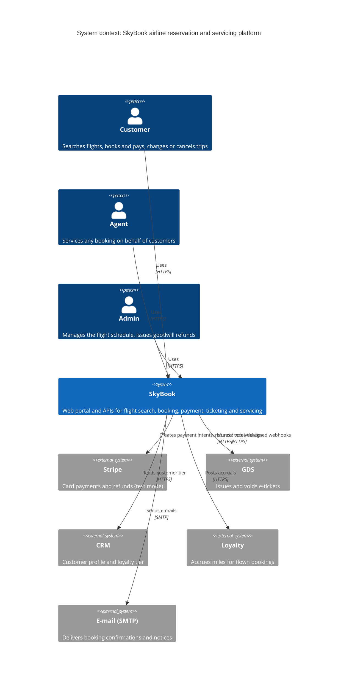
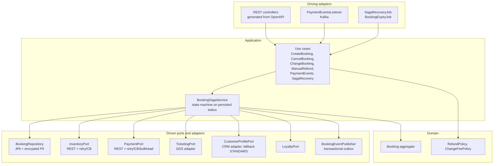
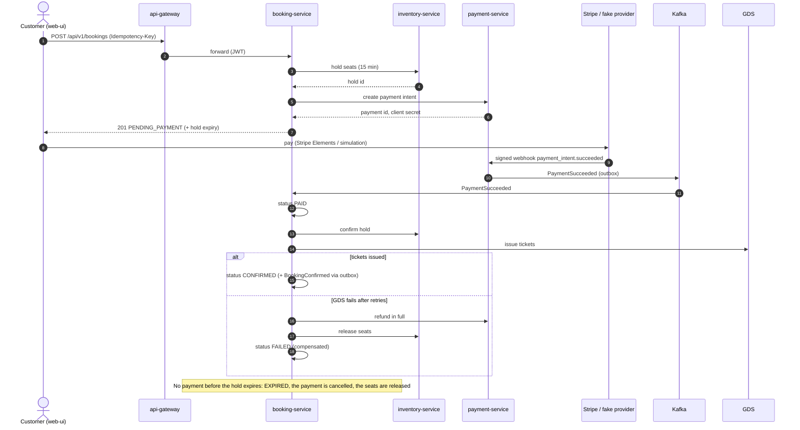

# SkyBook architecture (C4 model)

Four zoom levels, from the outside in: system context, containers, the components of the most complex
service (booking-service), and the booking saga at runtime. The diagrams are Mermaid, so GitHub renders
them and they change in the same pull request as the code.

## Level 1: System context

## Level 2: Containers

```mermaid
C4Container
  title Containers: services, data stores and messaging

  Person(user, "Customer / Agent / Admin")
  System_Ext(keycloak, "Keycloak", "OIDC identity provider: PKCE for the SPA, client credentials for services")
  System_Ext(stripe, "Stripe")
  System_Ext(partners, "GDS / CRM / Loyalty")

  System_Boundary(sb, "SkyBook") {
    Container(web, "web-ui", "React 19, TypeScript, nginx", "Customer and staff portal, WCAG 2.1 AA")
    Container(gw, "api-gateway", "Spring Cloud Gateway", "Single entry point: JWT validation, rate limiting, routing, circuit breaking")
    Container(inv, "inventory-service", "Spring Boot", "Flights, seat maps, seat holds, pricing; sole owner of seat allocation")
    Container(book, "booking-service", "Spring Boot, hexagonal", "Booking lifecycle; orchestrates the saga")
    Container(pay, "payment-service", "Spring Boot", "Payment intents, Stripe webhooks, refunds")
    Container(bridge, "event-bridge", "Spring Boot", "Forwards domain events from Kafka to Solace topics")
    Container(notif, "notification-service", "Spring Boot", "E-mails per event, audit trail")

    ContainerDb(oracle, "Oracle", "Oracle Free 23ai", "Flights, seats, holds")
    ContainerDb(redis, "Redis", "Redis 8", "Seat map read model, gateway rate limits")
    ContainerDb(bookdb, "Booking DB", "MariaDB 11", "Bookings, saga state, outbox (PII encrypted)")
    ContainerDb(paydb, "Payment DB", "MariaDB 11", "Payments, refunds, outbox")
    ContainerDb(mongo, "Audit store", "MongoDB 8", "Notification audit trail")
    ContainerQueue(kafka, "Kafka", "KRaft", "Domain events: booking and payment topics, DLTs")
    ContainerQueue(solace, "Solace PubSub+", "JMS", "Notification topics and a durable exclusive queue")
  }

  Rel(user, web, "Uses", "HTTPS")
  Rel(web, keycloak, "Signs in", "OIDC code + PKCE")
  Rel(web, gw, "Calls /api", "HTTPS, JWT")
  Rel(gw, inv, "Routes", "mTLS")
  Rel(gw, book, "Routes", "mTLS")
  Rel(gw, pay, "Routes", "mTLS")
  Rel(book, inv, "Holds / confirms / releases seats", "REST, mTLS, client credentials")
  Rel(book, pay, "Creates payments, refunds", "REST, mTLS, client credentials")
  Rel(book, partners, "Tickets, tier, accruals", "REST, Resilience4j")
  Rel(pay, stripe, "Payment intents, refunds", "HTTPS")
  Rel(inv, oracle, "Reads/writes", "JDBC")
  Rel(inv, redis, "Caches seat maps", "RESP")
  Rel(book, bookdb, "Reads/writes", "JDBC")
  Rel(pay, paydb, "Reads/writes", "JDBC")
  Rel(book, kafka, "Publishes via outbox, consumes payment events")
  Rel(pay, kafka, "Publishes via outbox")
  Rel(bridge, kafka, "Consumes")
  Rel(bridge, solace, "Publishes", "JMS")
  Rel(notif, solace, "Consumes q.notification", "JMS")
  Rel(notif, mongo, "Audits")
```

## Level 3: Components of booking-service

Hexagonal (ports and adapters, ADR-0005): the domain and application services have no framework
dependencies on the outside world; ArchUnit enforces the direction of dependencies.

## Runtime: the booking saga

The saga is orchestrated by booking-service and driven by the booking's persisted status, so a crash at
any step resumes from the database (SagaRecoveryJob). Every compensation is idempotent.

