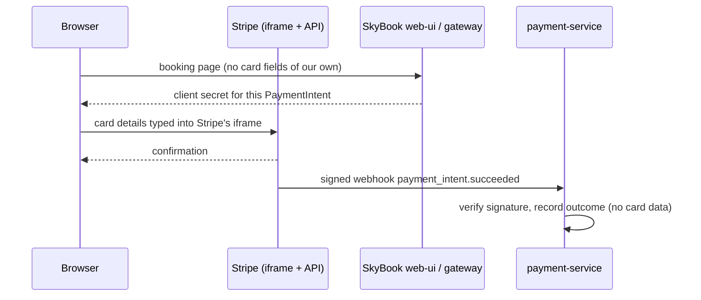

# PCI DSS scope note

**Goal:** keep SkyBook out of scope for cardholder-data storage and processing, so that compliance can be
attested with **SAQ A** (e-commerce merchants that fully outsource card handling) instead of SAQ D.

> This note records the design decisions behind that goal. It is not a compliance attestation; a
> Qualified Security Assessor or the acquiring bank confirms the applicable SAQ.

## How card data flows

1. The booking page loads **Stripe.js from `js.stripe.com`** and mounts the **Payment Element**, an iframe
   served by Stripe.
2. The customer types the card number, expiry and CVC **into Stripe's iframe**. The data goes from the
   browser directly to Stripe and never reaches SkyBook's servers or JavaScript.
3. SkyBook only ever handles:
   - the PaymentIntent id and its **client secret**, which authorises confirming one specific payment, not
     reading card data;
   - payment status;
   - amounts;
   - Stripe event ids.
4. Payment outcomes reach payment-service through **signed webhooks** (`Stripe-Signature`, HMAC-SHA256),
   verified before any state change.

## Controls that keep the scope small

| Requirement area | What SkyBook does |
|------------------|-------------------|
| No storage of account data (Req. 3) | No PAN, CVC, track data or expiry dates in any database, log, event or backup. Payment records hold only Stripe ids, amounts and statuses |
| Scripts on the payment page (Req. 6.4.3, 11.6.1) | A Content Security Policy limits scripts to `'self'` and `https://js.stripe.com`, and frames to Stripe. Images are built in CI from pinned dependencies and scanned |
| Secure transmission (Req. 4) | TLS at the ingress; mTLS between services; outbound Stripe calls over HTTPS with the official SDK |
| Secrets (Req. 8) | Stripe secret key and webhook secret come from Vault (`secret/payment-service`), not from images or Git |
| Logging (Req. 10) | Payment and refund events are recorded with correlation ids; webhook payloads are not logged in full |
| Change control (Req. 6) | Every change goes through CI: tests, contract tests, scanning. Deployments are environment-gated (ADR-0018) |

## Things that would bring SkyBook into a bigger scope (do not do these)

- Rendering our own card input fields, even if the data is sent straight to Stripe → SAQ A-EP.
- Logging request bodies on payment endpoints or storing raw webhook payloads that might contain card
  metadata beyond what is needed.
- Letting agents type card details on a customer's behalf (MOTO) through SkyBook screens.
- Adding third-party scripts (analytics, chat widgets) to the booking/payment page without CSP review.

## Test mode

Local and CI environments use Stripe **test mode** or the built-in fake provider (`PAYMENT_PROVIDER=fake`).
Test card numbers (e.g. `4242 4242 4242 4242`) are not real account data.
