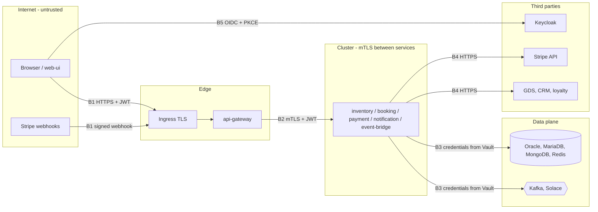

# Threat model

STRIDE analysis of SkyBook's data flows. Scope:
- the web UI;
- the gateway;
- the six services;
- their data stores and brokers;
- the integrations with Keycloak, Stripe and the partners.

Reviewed whenever a trust boundary changes, for example a new external integration or a new public
endpoint.

## Assets

| Asset | Why it matters |
|-------|----------------|
| Passenger personal data (names, dates of birth, e-mail) | GDPR; identity fraud |
| Payment state and refunds | Direct financial loss |
| Seat inventory | Overbooking or denial of sale |
| Access tokens, service credentials, encryption keys | Lead to every other asset |
| Booking and audit history | Disputes, regulatory evidence |

## Trust boundaries

## STRIDE findings and mitigations

| # | Threat (STRIDE) | Boundary | Mitigation in SkyBook | Residual risk |
|---|-----------------|----------|-----------------------|---------------|
| T1 | **Spoofing** a user with a stolen or forged token | B1 | JWT signature, issuer and expiry checked at the gateway **and** in every service (ADR-0008). Short-lived access tokens; PKCE stops code interception | Tokens readable by JavaScript (sessionStorage); see T10 |
| T2 | **Spoofing** a service inside the cluster | B2 | mTLS with per-service certificates from cert-manager. `client-auth: need`. Service calls also carry a client-credentials JWT with role SERVICE (ADR-0010) | A compromised pod can still use its own identity |
| T3 | **Spoofing** Stripe webhooks to mark bookings paid | B1 | `Stripe-Signature` HMAC verified with the webhook secret; timestamp tolerance; event ids de-duplicated (`processed_event`) | Secret leakage → rotate (runbook) |
| T4 | **Tampering** with prices or seats in requests | B1 | Prices are computed server-side from inventory, never taken from the client. Seat allocation is decided by inventory with optimistic locking (ADR-0006) | None identified |
| T5 | **Tampering** by replaying requests | B1 | Idempotency keys scoped to the caller; a reused key with a different body is rejected (ADR-0007) | None identified |
| T6 | **Repudiation** of refunds or cancellations | B2 | Manual refunds need ADMIN plus a mandatory note. Every state change emits an event (outbox) with a correlation id. Notification audit trail in MongoDB | Audit stores are not WORM; a tamper-evident log is future work |
| T7 | **Information disclosure** of personal data at rest | B3 | AES-256-GCM field encryption with key ids and rotation (ADR-0009); keys only in Vault | Data in memory and in logs: notification-service masks e-mail addresses in logs and audit records (`EmailMasking`); other services log references, not personal data. Events carry only what notifications need |
| T8 | **Information disclosure** across customers (IDOR) | B1/B2 | Ownership checked in booking-service (`Caller.current()`). Another customer's booking returns 404, not 403, to avoid enumeration. References are 6 random characters over a 32-symbol alphabet | Reference guessing is rate-limited at the gateway |
| T9 | **Information disclosure** in errors | B1 | RFC 9457 problems with stable codes; no stack traces; a correlation id instead of internals | None identified |
| T10 | **XSS** stealing tokens from the SPA | B1 | React escaping by default, no `dangerouslySetInnerHTML`. Strict CSP (`script-src 'self' js.stripe.com`), `frame-ancestors 'none'`, nosniff | Move tokens to a BFF with HttpOnly cookies (planned hardening) |
| T11 | **Denial of service** by request floods | B1 | Gateway rate limiting (Redis token bucket), body size limit at the ingress, HPA | Volumetric attacks need a CDN/WAF in front |
| T12 | **Denial of service** by slow partners exhausting threads | B4 | Timeouts, bulkheads, circuit breakers per partner (ADR-0015) | Long partner outages delay ticketing; the saga refunds after the deadline |
| T13 | **Denial of service** by seat hoarding (holds without paying) | B1 | Holds expire after 15 minutes; per-booking maximum of 9 seats; authenticated users only | A determined user can still create many bookings; per-user hold quotas are future work |
| T14 | **Elevation of privilege** to agent or admin | B1/B2 | Realm roles from Keycloak only; method-level `@PreAuthorize` in services, not just routes; ArchUnit keeps controllers behind security | Keycloak admin account is a high-value target: MFA required in production |
| T15 | **Elevation** through the supply chain | CI | Pinned dependencies, Dependabot, Trivy gate on dependencies and images, SBOM and provenance attestations, non-root read-only containers | Signing (cosign) and admission policies are future work |
| T16 | **Secrets** leaking from Git or images | CI/B3 | Secrets come from Vault via Kubernetes auth (one role per service). Trivy secret scanning. Development defaults are only for local stacks | Development secrets in compose files are public by design and must never be reused |

## Security testing in the pipeline

- **Unit and contract:** security configuration tests per service, `MutualTlsTest` (a rogue client
  certificate is rejected), and webhook signature tests.
- **API:** the Newman collection asserts 401 without a token, 403 for customers on admin APIs, and
  RFC 9457 problems.
- **Static and dependency analysis:** SonarQube (when configured), Trivy for vulnerabilities, secrets and
  IaC misconfiguration.
- **Recommended before go-live:**
  - an OWASP ZAP baseline scan against staging;
  - an external penetration test of the booking and payment flows.
